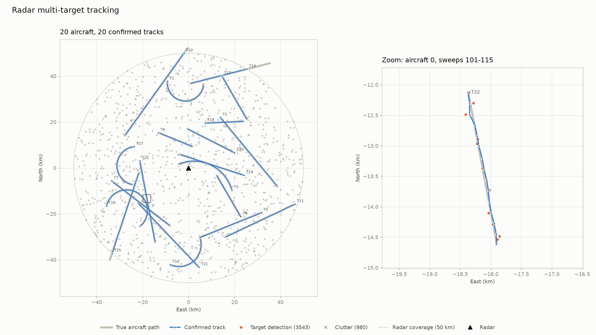

# radar-tracker

A from-scratch **radar multi-target tracker** in modern C++17. It simulates a sky full of
aircraft, a noisy radar that watches them, and a tracker that turns the radar's messy
blips back into clean, continuously identified aircraft tracks.

No external libraries: the matrix math, Kalman filter and assignment algorithm are all
implemented here.



## What it does

A real air-surveillance radar does not report "aircraft #7 is at (x, y)". Each sweep it
reports an unlabeled list of blips that are:

- **noisy**: position errors of tens to hundreds of metres, growing with distance
- **incomplete**: about 1 in 10 aircraft is missed on any given sweep
- **polluted**: false alarms ("clutter") from weather, birds and ground reflections

The tracker's job is to work out which blip belongs to which aircraft, smooth out the
noise, estimate each aircraft's velocity, and keep a stable ID on every aircraft while
ignoring clutter. This is the same core problem solved in air-traffic control, defence
systems, and self-driving-car perception.

## Pipeline

```
 ┌──────────┐   ┌──────────┐   ┌──────────┐   ┌──────────┐   ┌───────────┐   ┌──────────┐   ┌──────────┐
 │ Simulate │──▶│  Detect  │──▶│ Predict  │──▶│   Gate   │──▶│ Associate │──▶│  Update  │──▶│  Manage  │
 │ aircraft │   │  (radar) │   │ (Kalman) │   │ (chi-sq) │   │(Hungarian)│   │ (Kalman) │   │  tracks  │
 └──────────┘   └──────────┘   └──────────┘   └──────────┘   └───────────┘   └──────────┘   └────┬─────┘
       ▲                                                                                         │
       └──────────────────────────────── next sweep (dt = 1 s) ◀─────────────────────────────────┘
```

| Stage | What happens | Where |
|---|---|---|
| Simulate | Aircraft fly straight or in gentle coordinated turns at 80–250 m/s | `Simulator` |
| Detect | Range/bearing noise, 90% detection probability, Poisson clutter, shuffled order | `Simulator::sweep` |
| Predict | Constant-velocity Kalman prediction of every track to the current time | `KalmanFilter::predict` |
| Gate | Rule out impossible pairings using Mahalanobis distance (chi-square, 99.9%) | `Tracker::process` |
| Associate | Globally optimal one-to-one matching of tracks to detections (Global Nearest Neighbor) | `hungarian` |
| Update | Blend each matched detection into its track (Joseph-form covariance update) | `KalmanFilter::update` |
| Manage | Confirm tracks after 3 hits in 5 sweeps; delete after too many misses; start new tracks | `Tracker::process` |

### Technical highlights

- **Kalman filter** with a white-noise-acceleration process model, tuned for
  maneuvering airliners.
- **Polar-to-Cartesian measurement covariance**: each detection gets its own error
  ellipse, rotated to its bearing and stretched with range, because a radar's bearing
  error grows with distance.
- **Statistical gating** with the chi-square distribution, plus a cost of
  `d² + ln|S|` that properly compares tracks with different uncertainties.
- **Hungarian (Kuhn–Munkres) algorithm**, O(n³), with padding for unequal numbers of
  tracks and detections.
- **M-of-N track confirmation**, which keeps false tracks from clutter rare.
- **Compile-time-sized matrix library**: dimension mismatches are compile errors, and
  there are no heap allocations in the filter.
- Builds clean under `-Wall -Wextra -Wpedantic`, with unit and end-to-end tests run by
  CTest.

## Build, run, test

Requirements: a C++17 compiler and CMake 3.16+. Plotting also needs Python 3 with
matplotlib (`pip install matplotlib`).

```bash
cmake -S . -B build
cmake --build build

# Run the tests
ctest --test-dir build --output-on-failure

# Run the demo: radar_tracker [numTargets] [numSweeps] [seed]   (defaults: 20 200 42)
./build/radar_tracker
./build/radar_tracker 50 300 7

# Plot the run (reads the CSVs written by the demo, writes tracks.png)
python3 plot_tracks.py
```

The demo writes three CSV files to the current directory:

| File | Columns |
|---|---|
| `truth.csv` | `sweep, id, x, y, vx, vy, in_coverage` |
| `detections.csv` | `sweep, x, y, truth_id` (`-1` = clutter) |
| `tracks.csv` | `sweep, id, status, x, y, vx, vy` |

## Example results

Default run (`./build/radar_tracker`: 20 aircraft, 200 one-second sweeps, seed 42,
about 5 clutter blips per sweep):

```
=== Results ===
Targets in coverage (final sweep): 17 / 20
Confirmed tracks (final sweep):    17
Position RMS error, tracker:       43.7 m
Position RMS error, raw radar:     77.7 m  (44% reduction)
False-track rate:                  0.00% of confirmed track-sweeps (0 of 20 confirmed track IDs ever false)
Track ID switches:                 0
Avg tracker time per sweep:        0.028 ms
```

Averaged over 20 random seeds (20 aircraft, 200 sweeps each):

| Metric | Value |
|---|---|
| Position RMS error, tracker vs raw radar | **44.8 m vs 78.5 m** |
| False-track rate | **0.02%** of confirmed track-sweeps |
| Track ID switches | **0.25 per run** |

Timing was measured on an Apple Silicon laptop (Release build).

**How the results are scored:** each sweep, confirmed tracks are matched one-to-one to
true aircraft (within 1 km) using the same Hungarian solver. A confirmed track with no
match counts as false. An aircraft whose matched track ID changes counts as an ID
switch. The `truth_id` on each detection is used only for this scoring; the tracker
never sees it.

**Tuning:** the main parameter is the process noise `q`. Too small and the filter can't
follow turns: tracks fall behind, the aircraft's detections fall outside the gate, and
duplicate tracks and ID switches appear (about 4 switches per run at `q = 5`). Too large
and the filter overreacts to noise. `q = 20` gave the lowest error with near-zero
switches.

## Project layout

```
include/   Matrix.hpp  Simulator.hpp  KalmanFilter.hpp  Hungarian.hpp  Tracker.hpp
src/       Simulator.cpp  KalmanFilter.cpp  Hungarian.cpp  Tracker.cpp  main.cpp
tests/     test_main.cpp      (framework-free CHECK macro, registered with CTest)
plot_tracks.py                (matplotlib visualisation)
```

## Future work

- **IMM filter** (Interacting Multiple Model): run constant-velocity and coordinated-turn
  models side by side so the tracker adapts during maneuvers instead of using one
  compromise noise level.
- **Real ADS-B data**: feed real aircraft position reports (e.g. from OpenSky Network)
  through a simulated radar for realistic traffic.
- **Real-time display** with SFML or Dear ImGui: a live radar scope with track labels
  and velocity vectors.
- **Multithreading**: build the cost matrix in parallel and pipeline the simulation and
  tracking for very dense scenes.
- **GoogleTest**: move the lightweight CHECK-based tests to a full test framework with
  fixtures and parameterized tests.
